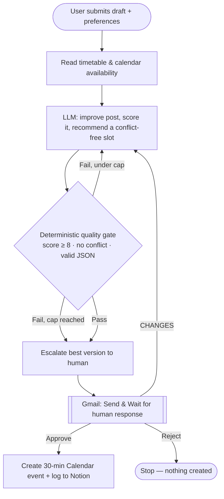

<div align="center">

# 📅 Schedule-Aware LinkedIn Content QA Agent

**An n8n-powered, human-approved AI publishing pipeline that drafts, scores, and schedules LinkedIn posts around a student's real timetable — without ever letting the AI act on its own.**


</div>

---

## 1. Project overview

**What it does.** This project turns a rough LinkedIn draft into a scored, scheduled, human-approved publishing event — timed around a student's actual class schedule. It is built as two independent n8n workflows:

- **Workflow 1 — Timetable Sync.** Converts an unstructured academic timetable (PDF, image, screenshot, Excel, CSV) into deterministic, recurring **Google Calendar** class events. This calendar becomes the single source of truth for "when am I actually busy."
- **Workflow 2 — Content QA Agent.** Takes a draft plus the user's calendar availability, has an LLM improve and score the post and recommend a realistic 30-minute publishing slot that avoids classes, then pauses for a **human approval** before creating a single publishing event and logging the decision in **Notion**.

**The problem it addresses.** Students and early-career creators juggle a changing class timetable and a content calendar at the same time. Doing both by hand produces three recurring failure modes:

1. **Timetable drift** — PDFs, screenshots, and ad-hoc spreadsheets are read once and never kept in sync, so the calendar stops matching reality.
2. **Unsafe AI output** — an LLM can produce fluent text that is wrong, off-tone, or simply not ready to publish. Acting on it automatically turns every hallucination into a public mistake.
3. **Publishing at the wrong time** — even a good post is wasted if it goes out during a lecture, a lab, or an exam.

The design goal is narrow and deliberate: make the *timetable* machine-actionable, the *content* human-approved, and the *publishing time* reasoned from real availability rather than guessed.



**Key design decision — publishing stays manual.** The system schedules a reminder event; the human writes and posts to LinkedIn themselves. The highest-risk action (a public post) is never handed to the AI.

---

## 2. Safety approach

The central question this project answers is: *how do you let an LLM help with a real-world action without ever letting it act unauthorized or irreversibly?* The answer is a layered contract — an LLM proposes, deterministic logic validates, and only a human authorises.

### 2.1 The governing principle: approval before irreversibility

Every irreversible action sits behind a single human approval gate. In n8n this is implemented with **Gmail "Send and Wait for Response"** — the workflow literally halts and cannot proceed until a human replies. There is no code path from LLM output to a Calendar write or a Notion entry that bypasses that response.

### 2.2 The eight guardrails

These are the safety contract. Any change that violates one is a redesign, not a refactor.

| # | Guardrail | What it prevents |
|---|-----------|------------------|
| 1 | The LinkedIn workflow **never** creates, updates, or deletes college class events. | Cross-contamination between the two workflows' data. |
| 2 | The system **never** sends Gmail or Slack messages outside the approval gate. | Spam or unauthorized outbound communication. |
| 3 | The system **never** creates a publishing Calendar event without explicit human approval. | Unauthorised side effects. |
| 4 | The system **never** auto-publishes to LinkedIn — publishing is manual by design. | The most damaging irreversible action (a public post). |
| 5 | AI revision loops are **bounded** (hard cap: 3 revisions). | Infinite loops, runaway API cost, and the AI grinding unattended. |
| 6 | All AI output must be **structured JSON**, validated before any action is taken. | Fluent prose silently triggering a side effect. |
| 7 | Every decision — approved, revised, or rejected — is **logged in Notion**. | Silent, unauditable actions. |
| 8 | Each external service (Calendar, Gmail, Slack, Notion) fails **independently**. | One service outage cascading into others. |

### 2.3 How the loop enforces it

Every irreversible action is reached through the same eight-step loop, and each step exists because the one before it isn't sufficient alone:

| Step | What happens | Why it matters for safety |
|------|--------------|---------------------------|
| **Input** | User submits draft + explicit preferences (topic, audience, tone, CTA, window, deadline). | Anchors the loop in human intent, not an implicit LLM assumption. |
| **Context** | Workflow reads real timetable and primary-calendar availability. | Scheduling becomes constraint satisfaction, not a guess. |
| **Reasoning** | LLM improves the post and recommends a time, returning structured JSON. | Reasoning is centralised, inspectable, and revisable. |
| **Validation** | A deterministic IF node checks score threshold, JSON schema, conflict flag, and revision count. | Catches LLM drift *before* a human is asked to decide. |
| **Approval** | Human chooses Approve / CHANGES / Reject via Gmail (+ Slack notification). | The **only** path to an irreversible action. |
| **Execution** | On approval, create the Calendar event and send confirmations. | Side effects occur in the smallest possible set of places. |
| **Logging** | Every accepted, revised, and rejected decision is written to Notion. | The system is auditable after the fact. |
| **Error recovery** | JSON parse and Calendar/Gmail/Slack/Notion failures are handled per service. | A Slack outage cannot break a Calendar write; bad JSON cannot crash the loop. |

### 2.4 The quality gate — deterministic, not model-driven

The LLM cannot decide whether its own output is good enough to proceed. A **deterministic IF node** enforces all four conditions before any approval request is sent:

- `overall_score >= 8`
- `needs_revision == false`
- `recommended_publish_time` is not empty
- `calendar_conflict == false`

If the gate fails, the draft is sent back for revision — up to **3 times**. If it still fails after the third attempt, the *best available version* is escalated to the human for manual review. It is **never** auto-published.

### 2.5 Reversible-by-default outcomes

| Human response | Calendar event | Notion record | Net effect |
|----------------|----------------|---------------|------------|
| `Approve` | ✅ Created | ✅ Saved | The only path that produces a side effect. |
| `CHANGES: <feedback>` | ⛔ Not created | ⛔ Not created | One bounded revision, then re-approval. |
| `Reject` | ⛔ Not created | ✅ Rejection logged | Workflow stops; nothing scheduled. |
| *(any other reply)* | ⛔ Not created | ⛔ Not created | Treated as no-response; workflow stays paused. |

---

## 3. Supporting evidence

### 3.1 Documentation in this repository

The architecture and safety design are documented in this README, including:

- **System architecture** — the two-workflow separation and data flow (see the diagram in §1).
- **Formal JSON schemas** — the class-entry schema (Workflow 1) and the QA-result schema (Workflow 2) that the LLM must conform to. These are the machine-checkable contracts that make the deterministic gate possible.
- **The eight-rule safety contract** (§2.2) and the loop model (§2.3).
- **The Notion data model** — the full property list that defines the audit log.

<details>
<summary><strong>📄 QA-result schema (Workflow 2) — the contract the LLM must satisfy</strong></summary>

```json
{
  "$schema": "https://json-schema.org/draft/2020-12/schema",
  "title": "QAResult",
  "type": "object",
  "required": [
    "improved_post", "hook", "clarity_score", "hook_score",
    "technical_value_score", "overall_score", "issues", "improvements",
    "hashtags", "recommended_publish_time", "calendar_conflict",
    "scheduling_reason", "needs_revision"
  ],
  "properties": {
    "improved_post":          { "type": "string" },
    "hook":                   { "type": "string" },
    "clarity_score":          { "type": "integer", "minimum": 0, "maximum": 10 },
    "hook_score":             { "type": "integer", "minimum": 0, "maximum": 10 },
    "technical_value_score":  { "type": "integer", "minimum": 0, "maximum": 10 },
    "overall_score":          { "type": "integer", "minimum": 0, "maximum": 10 },
    "issues":                 { "type": "array", "items": { "type": "string" } },
    "improvements":           { "type": "array", "items": { "type": "string" } },
    "hashtags":               { "type": "array", "items": { "type": "string" } },
    "recommended_publish_time": {
      "type": "string",
      "description": "ISO 8601 timestamp with +05:30 offset, e.g. 2026-04-12T17:30:00+05:30"
    },
    "calendar_conflict":      { "type": "boolean" },
    "scheduling_reason":      { "type": "string" },
    "needs_revision":         { "type": "boolean" }
  }
}
```

</details>

### 3.2 End-to-end test scenarios (development-time, manual)

The following scenarios were exercised end to end during development. Each row records the expected behaviour and the observed result.

| Scenario | Expected | Observed |
|----------|----------|----------|
| Clean first-attempt approval with an empty calendar | Gate passes first try; approval creates the event, sends confirmations, saves to Notion. | Gate passed first try; event created, confirmations sent, Notion entry saved. |
| Conflict-avoidance with a 1–4 PM window overlapping classes | Agent recommends a later slot with a stated reason; no conflict flagged. | Agent recommended 5:30 PM with a stated reason; `calendar_conflict` was `false`. |
| `CHANGES: <feedback>` path | Revision count → 1; revised post re-submitted for approval; scheduled and logged on approval. | Revision count → 1; revised post approved, scheduled, and logged. |
| `Reject` path | Workflow stops; no event; no confirmations; rejection logged in Notion. | Workflow stopped; no event; no confirmations; rejection logged in Notion. |

### 3.3 Example: the approval decision surface

The approval email is the human's single point of control. It presents the improved post, the overall score, the recommended publish time and reason, and exactly three valid responses — `Approve`, `CHANGES: <feedback>`, or `Reject`. A parallel Slack notification mirrors the same decision point. This is a deliberately small, unambiguous surface: the human is never asked to interpret free-form model output to authorise an action.

### 3.4 Not yet available

Stated plainly, so no one is misled by what this repository does and does not yet contain:

- **No demo video** and **no UI screenshots** are included yet.
- **No exported n8n workflow JSONs**, prompt files, or standalone schema files are published in this repository — it currently contains this documentation and the license. The workflow exports are planned to be added (see Limitations).

---

## 4. Limitations

- **Publishing is manual by design.** The system schedules a Calendar event; the human posts to LinkedIn. Direct publishing is on the roadmap and would remain gated behind the `Approve` branch only.
- **The workflow exports are not yet published in this repository.** The design is fully documented here, but the importable `workflows/*.json`, prompt files, and standalone schema files are not yet committed — so the system cannot currently be reproduced from this repo alone. This is the most significant gap.
- **No automated test suite.** The four scenarios in §3.2 are manual, development-time checks. There is no CI, no regression suite, and no automated validation of the safety contract.
- **Quality depends on the chosen LLM.** Switching providers changes tone, scoring, and scheduling behaviour. The `overall_score >= 8` threshold is a fixed heuristic, not a calibrated measure.
- **The 3-revision cap has not been stress-tested** against a deliberately weak draft. The documented behaviour — escalate the best version to manual review — is designed but not yet empirically validated.
- **Vision-based timetable extraction should be human-reviewed** before approval. It is high quality but not infallible; the approval gate exists precisely so a human can catch extraction errors.
- **Single-user only.** Multi-user support, shared review queues, and per-user approval routing are not implemented.

---

<div align="center">

**Author:** Nishant Das · [GitHub](https://github.com/NishantDas0079) · [LinkedIn](https://linkedin.com/in/nishant-das-69470437a) · [X](https://x.com/BuildWithND)

Released under the [MIT License](./LICENSE) · Built in public, with honest limitations.

</div>
