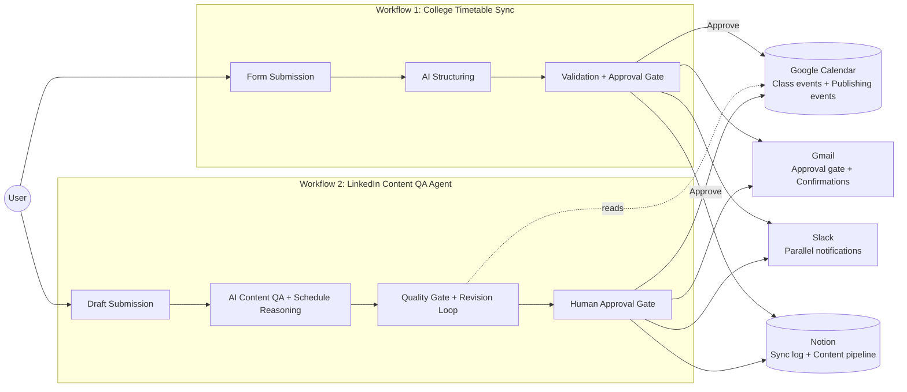
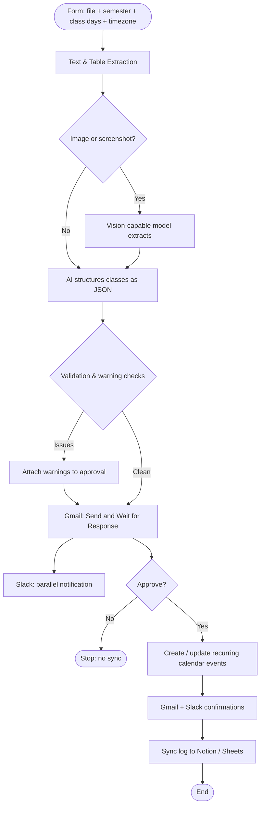
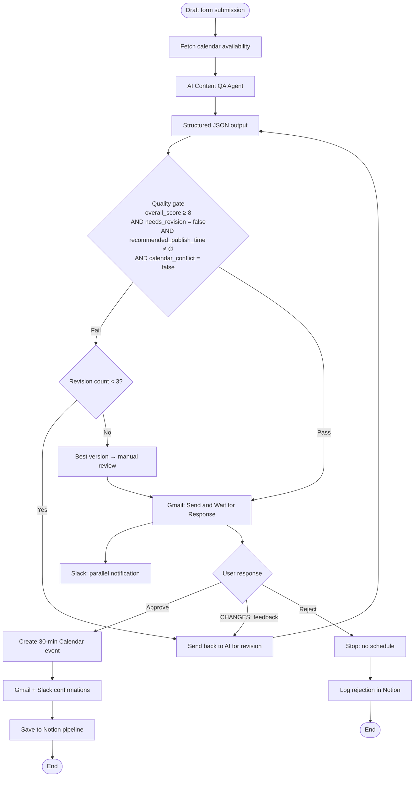
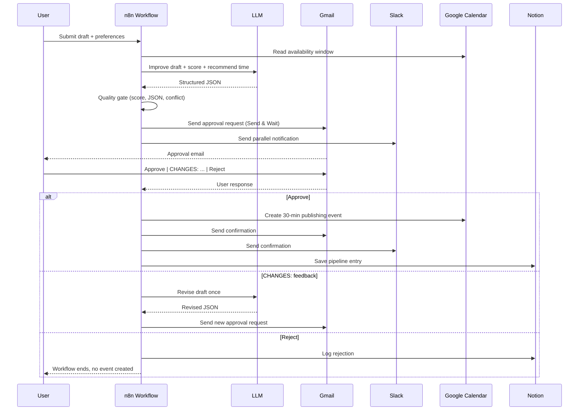

<div align="center">

# 📅 Schedule-Aware LinkedIn Content QA Agent

**An n8n-powered two-workflow system that keeps a college timetable accurate in Google Calendar and uses that schedule to safely draft, score, and schedule LinkedIn posts — with a human approval gate before every high-impact action.**

</div>

<div align="center">


</div>

<div align="center">

<!-- TODO: add a 60–90 second demo video walking through both workflows on the n8n canvas -->

</div>

---

## 📑 Table of Contents

- [Abstract](#-abstract)
- [Problem Statement & Motivation](#-problem-statement--motivation)
- [Objectives & Design Principles](#-objectives--design-principles)
- [System Architecture](#-system-architecture)
- [Workflow 1 — College Timetable Sync](#-workflow-1--college-timetable-sync)
- [Workflow 2 — LinkedIn Content QA Agent](#-workflow-2--linkedin-content-qa-agent)
- [The Loop-Engineering Model](#-the-loop-engineering-model)
- [Data Model — Notion "LinkedIn Content Pipeline"](#-data-model--notion-linkedin-content-pipeline)
- [Safety Rules & Guardrails](#-safety-rules--guardrails)
- [Tech Stack & Roles](#-tech-stack--roles)
- [Setup & Installation](#-setup--installation)
- [Usage Guide](#-usage-guide)
- [Troubleshooting](#-troubleshooting)
- [Testing & Validation](#-testing--validation)
- [Limitations](#-limitations)
- [Roadmap / Future Work](#-roadmap--future-work)
- [Repository Structure](#-repository-structure)
- [Contributing, License, Author, Acknowledgements](#-contributing-license-author-acknowledgements)

---

## 🔬 Abstract

This project presents a separation-of-concerns approach to AI-assisted content publishing by decomposing the problem into two independently auditable n8n workflows: a *timetable synchronization* workflow that turns unstructured academic schedules into a reliable Google Calendar source of truth, and a *content quality-assurance* workflow that consumes that schedule to draft, score, and schedule LinkedIn posts. The system operationalises a "human-on-the-loop" pattern in which an LLM prepares structured outputs and recommendations, deterministic validation enforces a quantitative quality gate, and an asynchronous Gmail-based approval handshake authorises every irreversible action. A revision cap, a structured-JSON contract, and a parallel Slack notification channel collectively bound the blast radius of LLM failure, while a Notion-backed audit log preserves a complete trace of every accepted and rejected decision.

---

## ❓ Problem Statement & Motivation

Students and early-career creators juggle two things at once: a class timetable that is constantly changing, and a content calendar that needs to respect it. Doing both manually produces three failure modes that this project tries to eliminate:

1. **Drift between the real timetable and what is actually in the calendar.** PDF timetables, screenshots, and ad-hoc Excel sheets are not actionable; they are read once and forgotten.
2. **LLM outputs that look fluent but are unsafe to act on.** Generating, scheduling, or publishing content without explicit human approval turns every hallucination into a public mistake.
3. **Posting at the wrong time.** Even a good draft is wasted if it goes out during a lecture, an exam, or a known busy block.

The motivation is to build a system where the *timetable* is machine-actionable, the *content* is human-approved, and the *publishing time* is reasoned from real availability rather than guessed.

---

## 🎯 Objectives & Design Principles

**Objectives**

- Convert unstructured timetable inputs (PDF, image, screenshot, Excel, CSV) into deterministic Google Calendar events.
- Use the same calendar as a constraint for LinkedIn content scheduling.
- Score draft posts against objective criteria before they ever reach a human reviewer.
- Keep a human approval gate as the only path to a published event.
- Maintain a full audit trail of every accepted, revised, and rejected post.

**Design Principles**

- **Separation.** Workflow 1 writes class events; Workflow 2 only reads calendar availability and writes one publishing event after approval. Neither workflow touches the other's data.
- **Structured contracts.** The LLM returns JSON, not prose. The workflow validates against a schema before acting.
- **Bounded autonomy.** The AI can revise up to a fixed cap. After that, the best available version is sent for human review; it is never published silently.
- **Approval before irreversibility.** Gmail *Send and Wait for Response* is the only mechanism that unlocks a Calendar write or a Notion pipeline entry.
- **Blast-radius isolation.** JSON parsing, Calendar calls, Gmail calls, Slack calls, and Notion calls are handled independently, so a failure in one does not cascade.

---

## 🏗 System Architecture

The system is intentionally two separate workflows. Workflow 1 produces a clean, queryable calendar of class events. Workflow 2 *reads* that calendar (and the user's primary calendar) to decide when a LinkedIn post is realistic to publish, and *writes* a single publishing event after human approval.



**The separation principle.** Workflow 1 is the only writer of class events. Workflow 2 is the only writer of publishing events. They share Google Calendar as a contract and Notion as an audit log, but they share no other state. This makes each workflow independently debuggable, testable, and replaceable, and limits the blast radius of a failure in either to a single concern.

---

## 🗓 Workflow 1 — College Timetable Sync

**Purpose:** turn a messy, human-formatted timetable into a deterministic, queryable Google Calendar of class events — but only after a human has seen and approved the structured version.

### Stages

1. **Form submission.** The user submits the source material through a form: a timetable file (PDF, image, screenshot, Excel, or CSV), the semester name, an effective date range, the class days, the timezone, and optional notes.
2. **Extraction.** Text and table extraction handle PDFs and spreadsheets. Images and screenshots are routed to a vision-capable model.
3. **AI structuring.** The extracted content is converted into a structured class list. Each class is described as JSON so the downstream nodes can validate it deterministically.
4. **Validation & warning checks.** Required fields, time-format sanity, room-format checks, and obvious duplicates raise warnings that travel with the approval request.
5. **Approval.** The structured class list is sent to **Gmail (Send and Wait for Response)** — the official approval gate — and to **Slack** in parallel. The workflow pauses until Gmail returns a response.
6. **Sync.** On approval, the workflow creates or updates recurring weekly events in a dedicated **College Timetable** calendar. Existing matching events are updated rather than duplicated.
7. **Confirmation & log.** Gmail and Slack receive a confirmation, and a sync log entry is written to Notion or Google Sheets.

### AI Structuring Example (JSON)

```json
{
  "subject": "Data Structures",
  "faculty": "Prof. Sharma",
  "day": "Monday",
  "start_time": "09:00",
  "end_time": "10:00",
  "room": "LT-3",
  "class_type": "Lecture",
  "recurrence": "Weekly"
}
```

<details>
<summary><strong>📄 Full Workflow 1 class-object schema (click to expand)</strong></summary>

```json
{
  "$schema": "https://json-schema.org/draft/2020-12/schema",
  "title": "ClassEntry",
  "type": "object",
  "required": [
    "subject",
    "faculty",
    "day",
    "start_time",
    "end_time",
    "room",
    "class_type",
    "recurrence"
  ],
  "properties": {
    "subject":     { "type": "string", "description": "Course name" },
    "faculty":     { "type": "string", "description": "Instructor name" },
    "day":         { "type": "string", "enum": ["Monday","Tuesday","Wednesday","Thursday","Friday","Saturday","Sunday"] },
    "start_time":  { "type": "string", "pattern": "^([01]\\d|2[0-3]):[0-5]\\d$" },
    "end_time":    { "type": "string", "pattern": "^([01]\\d|2[0-3]):[0-5]\\d$" },
    "room":        { "type": "string", "description": "Room or lab identifier" },
    "class_type":  { "type": "string", "enum": ["Lecture","Tutorial","Lab","Seminar"] },
    "recurrence":  { "type": "string", "enum": ["Weekly","Biweekly","One-off"] },
    "notes":       { "type": "string" }
  }
}
```

</details>



<div align="center">

<!-- TODO: add a screenshot of the n8n canvas for Workflow 1 -->
<!-- TODO: add a screenshot of a sample approval email for Workflow 1 -->

</div>

---

## ✍️ Workflow 2 — LinkedIn Content QA Agent

**Purpose:** turn a rough draft into a scored, scheduled, approved publishing event — with a real availability check against the user's calendar and a human-in-the-loop approval before anything is created.

### Stage 1 — Draft submission form

The user submits:

- Post topic
- Target audience
- Desired tone
- Call to action
- Rough draft
- Optional project link
- Preferred publishing window
- Publishing deadline

### Stage 2 — Calendar context

The workflow reads event titles, start times, and end times from the user's **primary Google Calendar** and from the **College Timetable** calendar, scoped to the selected window.

### Stage 3 — AI Content QA Agent

The LLM receives the draft plus the calendar context and returns a structured JSON object. The agent has two jobs: **content QA** (clarity, hook, technical value, tone, formatting) and **schedule reasoning** (recommend a realistic 30-minute slot that avoids classes).

<details>
<summary><strong>📄 Full AI agent output schema (click to expand)</strong></summary>

```json
{
  "$schema": "https://json-schema.org/draft/2020-12/schema",
  "title": "QAResult",
  "type": "object",
  "required": [
    "improved_post",
    "hook",
    "clarity_score",
    "hook_score",
    "technical_value_score",
    "overall_score",
    "issues",
    "improvements",
    "hashtags",
    "recommended_publish_time",
    "calendar_conflict",
    "scheduling_reason",
    "needs_revision"
  ],
  "properties": {
    "improved_post":          { "type": "string" },
    "hook":                   { "type": "string" },
    "clarity_score":          { "type": "integer", "minimum": 0, "maximum": 10 },
    "hook_score":             { "type": "integer", "minimum": 0, "maximum": 10 },
    "technical_value_score":  { "type": "integer", "minimum": 0, "maximum": 10 },
    "overall_score":          { "type": "integer", "minimum": 0, "maximum": 10 },
    "issues":                 { "type": "array", "items": { "type": "string" } },
    "improvements":           { "type": "array", "items": { "type": "string" } },
    "hashtags":               { "type": "array", "items": { "type": "string" } },
    "recommended_publish_time": {
      "type": "string",
      "description": "ISO 8601 timestamp with +05:30 offset, e.g. 2026-04-12T17:30:00+05:30"
    },
    "calendar_conflict":      { "type": "boolean" },
    "scheduling_reason":      { "type": "string" },
    "needs_revision":         { "type": "boolean" }
  }
}
```

</details>

### Stage 4 — Quality-control loop

An IF node passes the draft forward only when **all** of the following hold:

- `overall_score >= 8`
- `needs_revision` is `false`
- `recommended_publish_time` is not empty
- `calendar_conflict` is `false`

If the gate fails, the draft, the listed issues, and the listed improvements are sent back to the AI for revision. The cap is **3 revisions**. If the gate still fails after the third revision, the best available version is sent to the user for manual review rather than auto-publishing.

### Stage 5 — Human approval

The improved post, the score, the recommended time, and the response options are sent to **Gmail (Send and Wait for Response)** and to **Slack** in parallel. The workflow pauses until Gmail returns a response.

### Stage 6 — Approved actions

On approval, the workflow:

- Creates a **30-minute** Calendar event titled `Publish LinkedIn Post: [Post Topic]`. The event description contains the final post, hashtags, project link, score, and the approval timestamp.
- Sends Gmail and Slack confirmations.
- Saves an entry to the **Notion "LinkedIn Content Pipeline"** database.



### Approval response outcomes

| User response            | Workflow behaviour                                                                                                                                              | Calendar event | Notion record | Notifications       |
|--------------------------|-----------------------------------------------------------------------------------------------------------------------------------------------------------------|----------------|---------------|---------------------|
| `Approve`                | Create the 30-min publishing event, send confirmations, save a pipeline entry.                                                                                  | ✅ Created     | ✅ Saved      | Gmail + Slack sent  |
| `CHANGES: <feedback>`    | Send the draft, feedback, issues, and improvements back to the AI for **one** revision, then re-request approval.                                               | ⛔ Not yet     | ⛔ Not yet    | New approval round  |
| `Reject`                 | Stop the workflow. Do not schedule. Log the rejection in Notion.                                                                                                | ⛔ Not created | ✅ Logged     | ⛔ None             |



<div align="center">

<!-- TODO: add a screenshot of the n8n canvas for Workflow 2 -->
<!-- TODO: add a screenshot of a sample Slack message -->
<!-- TODO: add a screenshot of a created Calendar publishing event -->
<!-- TODO: add a screenshot of the Notion pipeline with a logged entry -->

</div>

---

## 🔁 The Loop-Engineering Model

Every irreversible action in this system is reached through the same eight-step loop. Each step exists because the previous one is not enough on its own.

| Step        | What happens                                                                                              | Why it matters                                                                 |
|-------------|-----------------------------------------------------------------------------------------------------------|--------------------------------------------------------------------------------|
| **Input**   | The user submits a draft and explicit preferences (topic, audience, tone, CTA, window, deadline).         | Anchors the loop in human intent, not implicit LLM assumption.                  |
| **Context** | The workflow reads real timetable and primary-calendar availability for the selected window.               | Scheduling becomes a constraint satisfaction problem, not a guess.             |
| **Reasoning** | The LLM improves the post and recommends a publish time, returning structured JSON.                    | Reasoning is centralised, inspectable, and revisable.                           |
| **Validation** | A deterministic IF node checks score threshold, JSON schema, conflict flag, and revision count.        | Catches LLM drift before any user is asked to decide.                           |
| **Approval** | The user is asked once (or once per revision) to choose Approve / CHANGES / Reject, via Gmail + Slack.    | The only path to an irreversible action.                                         |
| **Execution** | On approval, the workflow creates the Calendar event and sends confirmations.                           | Side effects happen in the smallest possible set of places.                     |
| **Logging** | Every accepted, revised, and rejected decision is written to Notion with score, time, and timestamp.     | The system is auditable after the fact.                                         |
| **Error recovery** | JSON parse errors and Calendar / Gmail / Slack / Notion failures are handled independently per service. | A Slack outage does not break Calendar writes; a malformed JSON does not crash the loop. |

---

## 🗂 Data Model — Notion "LinkedIn Content Pipeline"

The Notion database is the durable record of every post the agent has touched. Property names must match exactly as shown below; n8n writes by property name.

<details>
<summary><strong>📄 Notion property list (click to expand)</strong></summary>

| Property              | Type    | Notes                                                  |
|-----------------------|---------|--------------------------------------------------------|
| Title                 | title   | Post topic; also the Notion row identifier.            |
| Status                | select  | e.g. `Draft`, `In Review`, `Approved`, `Rejected`.     |
| Gmail Confirmation    | select  | `Pending`, `Sent`, `Replied`.                          |
| Slack Confirmation    | select  | `Pending`, `Sent`.                                     |
| Final Post            | text    | The approved post body.                                |
| Hook                  | text    | Opening line used.                                     |
| Hashtags              | text    | Comma- or newline-separated.                           |
| Calendar Conflict     | text    | `true` / `false` snapshot at decision time.            |
| Scheduling Reason     | text    | One-sentence justification from the agent.             |
| Overall Score         | number  | 0–10.                                                  |
| Clarity Score         | number  | 0–10.                                                  |
| Hook Score            | number  | 0–10.                                                  |
| Technical Value Score | number  | 0–10.                                                  |
| Revision Count        | number  | 0–3.                                                   |
| Recommended Publish Time | date | ISO 8601, +05:30.                                      |
| Approval Date         | date    | Set when the user approves.                            |
| Project Link          | url     | Optional external reference.                           |

</details>

**Required setup step:** the database must be shared with the n8n Notion connection before any workflow run, or the Notion write will fail.

---

## 🛡 Safety Rules & Guardrails

<details>
<summary><strong>📜 Full safety-rules list (click to expand)</strong></summary>

1. The LinkedIn workflow **never** creates, updates, or deletes college class events.
2. The system **never** sends Gmail or Slack messages without going through the approval gate.
3. The system **never** creates a publishing Calendar event without explicit human approval.
4. The system **never** auto-publishes to LinkedIn. Publishing is manual by design.
5. AI revision loops are always **bounded** (current cap: 3).
6. All AI decisions are required to come back as **structured JSON** that is validated before acting.
7. Every final decision — approved, revised, or rejected — is **logged in Notion**.
8. Each external service (Calendar, Gmail, Slack, Notion) is wired so a failure in one does not silently cascade into another.

</details>

These rules are the contract that makes the system safe to leave running unattended for hours. If any future change violates one of them, the change is a redesign, not a refactor.

---

## 🧩 Tech Stack & Roles

| Component         | Role in the system                                                                                                |
|-------------------|-------------------------------------------------------------------------------------------------------------------|
| **n8n**           | Orchestrator: triggers, branches, IF gates, revision loops, approval waits, and integration wiring.              |
| **Google Calendar** | Source of truth for class events (Workflow 1) and for availability context + publishing events (Workflow 2).   |
| **Gmail**         | Approval gate via *Send and Wait for Response*, plus confirmations and reminders.                                |
| **Slack**         | Parallel notification channel; the user sees the same decision points in two places.                             |
| **Notion**        | Durable content pipeline database and audit log.                                                                  |
| **LLM**           | Content improvement, scoring, timetable extraction (text + vision), and schedule reasoning.                       |

---

## ⚙️ Setup & Installation

### Prerequisites

- A running **n8n** instance (self-hosted or cloud).
- A **Google Cloud** project with the **Google Calendar API** enabled and OAuth credentials configured in n8n.
- **Gmail** OAuth credentials configured in n8n.
- **Slack** workspace credentials and an incoming-webhook / app configured in n8n.
- A **Notion** integration that is shared with the target workspace and database.
- An **LLM API key** (OpenAI, Anthropic, or any provider supported by your n8n LLM node).
- A dedicated **College Timetable** Google Calendar (Workflow 1 writes here; Workflow 2 reads from here).

### Steps

1. **Clone the repository.**
   ```bash
   git clone https://github.com/NishantDas0079/schedule-aware-linkedin-qa-agent.git
   cd Schedule-Aware-Linkedin-QA-Agent
   ```
2. **Copy environment template.** Fill credential names only — never commit secrets.
   ```bash
   cp .env.example .env
   ```
3. **Import the workflow JSONs** from `workflows/` into n8n. Replace all credential IDs and node IDs with your own.
4. **Configure credentials in n8n** for Google Calendar, Gmail, Slack, Notion, and your LLM provider.
5. **Create the Notion database** named **"LinkedIn Content Pipeline"** with the exact property names listed above. Share it with the n8n Notion integration.
6. **Run Workflow 1 first.** Until the College Timetable calendar has real class events, Workflow 2 has no real availability to reason about.
7. **Run Workflow 2** by submitting a draft through its form.

---

## 📖 Usage Guide

### Submitting a draft (Workflow 2)

Open the Workflow 2 form and fill in: post topic, target audience, desired tone, call to action, rough draft, optional project link, preferred publishing window, and publishing deadline. Submit. The workflow will fetch calendar context, run the AI agent, and only pause for your decision once the quality gate has passed.

### Responding to the approval email

The approval email arrives with the improved post, the score, the recommended publish time, and three valid response forms:

| You reply                | What happens                                                                                         |
|--------------------------|------------------------------------------------------------------------------------------------------|
| `Approve`                | The 30-min publishing event is created, confirmations are sent, and the entry is saved to Notion.    |
| `CHANGES: <your feedback>` | The draft, your feedback, the issues, and the improvements go back to the AI for one revision. The revised version is sent for approval again. |
| `Reject`                 | The workflow stops. No event is created. The rejection is logged in Notion.                          |

Any other response is treated as no-response and the workflow remains paused.

---

## 🩺 Troubleshooting

<details>
<summary><strong>🔧 Common issues and fixes (click to expand)</strong></summary>

**Approval email never arrives.**
- Check that the Gmail OAuth scope in n8n includes send + wait-for-response.
- Confirm the recipient address on the *Send and Wait for Response* node matches the address that should receive the approval request.
- Verify the workflow is not stuck behind a previous IF node that has not received its required input.

**Notion write fails with "object not found".**
- The database must be explicitly shared with the n8n Notion integration from inside Notion (Share → Add connection). Adding the integration to the workspace is not enough.
- Confirm the property names in the Notion database match the canonical list in [Data Model](#-data-model--notion-linkedin-content-pipeline) exactly — Notion property names are case-sensitive and any mismatch will fail silently.

**Calendar event is created at the wrong time.**
- Check that `recommended_publish_time` is being returned as a full ISO 8601 timestamp with the `+05:30` offset, not a bare local time.
- Confirm the n8n instance is configured for the same timezone as the user's primary Google Calendar.

**Quality gate keeps failing.**
- Inspect the AI agent's structured JSON output in the n8n execution log. The gate requires `overall_score >= 8`, `needs_revision = false`, a non-empty `recommended_publish_time`, and `calendar_conflict = false`. Any single failure routes the draft back into the revision loop.
- If the same draft is failing repeatedly, the revision cap will trip after 3 attempts and the best available version will be sent for manual review.

**Slack notification is missing.**
- Slack is sent in parallel to Gmail but is not on the critical path. A Slack failure should not block the approval or the Calendar write. Check the n8n execution log for the Slack node's error and the channel ID.

**Workflow 2 runs before Workflow 1.**
- This is allowed but not useful. Until the College Timetable calendar has class events, the calendar-context stage has nothing to constrain the recommended publish time.

</details>

---

## 🧪 Testing & Validation

The scenarios below were exercised end to end during development. Each row records what was expected and what was observed.

| Scenario | Expected | Observed |
|----------|----------|----------|
| Clean first-attempt approval with an empty calendar | Quality gate passes on first try; approval creates the publishing event, sends confirmations, saves to Notion. | Quality gate passed on first try; event was created, confirmations were sent, entry was saved to Notion. |
| Conflict-avoidance run with a 1–4 PM window overlapping classes | Agent recommends a 5:30 PM slot with a stated reason; no calendar conflict flagged. | Agent recommended 5:30 PM with a stated reason; calendar conflict flag was `false`. |
| `CHANGES: feedback` path | Revision count increments to 1; revised post is re-submitted for approval; on approval it is scheduled and logged. | Revision count incremented to 1; revised post was approved, scheduled, and logged. |
| `Reject` path | Workflow stops; no Calendar event is created; no confirmations are sent; rejection is logged in Notion. | Workflow stopped; no event was created; no confirmations were sent; rejection was logged in Notion. |

**Not tested:** the 3-revision cap under a deliberately very weak draft. See [Limitations](#-limitations).

---

## ⚠️ Limitations

- **Final publishing to LinkedIn is manual by design.** The system schedules the event; the user posts.
- **Quality depends on the chosen LLM.** Switching providers changes tone, scoring, and reasoning behaviour.
- **Timetable extraction from images and screenshots should be reviewed before approving.** Vision-model output is high-quality but not infallible; the approval gate exists precisely so a human can catch mistakes.
- **The 3-revision cap has not been stress-tested** against a deliberately weak draft. Current behaviour is to send the best available version to manual review, but that path is not yet empirically validated.
- **Single-user setup.** Multi-user support and shared review queues are not implemented.

---

## 🛣 Roadmap / Future Work

- **Direct LinkedIn publishing from the `Approved` branch only.** A connected LinkedIn account would let the system publish a post automatically — but only from the `Approve` response, never from `CHANGES` or `Reject`, keeping the approval gate in place. (Planned — not yet implemented.)
- _Idea, not a commitment:_ a lightweight error-handling dashboard that surfaces recent Slack / Gmail / Calendar / Notion failures.
- _Idea, not a commitment:_ multi-user support, including shared review queues and per-user approval routing.

---

## 📁 Repository Structure

```text
.
├── README.md
├── LICENSE
├── workflows/
│   ├── timetable-sync.json         # Workflow 1 export (credentials and IDs removed)
│   └── linkedin-qa-agent.json      # Workflow 2 export (credentials and IDs removed)
├── prompts/
│   ├── extraction-agent.system.md  # System prompt for timetable extraction
│   └── qa-agent.system.md          # System prompt for the Content QA agent
├── schemas/
│   ├── class-entry.schema.json     # JSON schema for a single class entry
│   ├── qa-result.schema.json       # JSON schema for the AI agent output
│   └── notion-properties.md        # Canonical list of Notion property names
├── docs/
│   ├── architecture/
│   │   ├── overview.png            # High-level architecture diagram
│   │   ├── workflow-1.png          # Workflow 1 canvas screenshot
│   │   └── workflow-2.png          # Workflow 2 canvas screenshot
│   ├── screenshots/
│   │   ├── approval-email.png
│   │   ├── slack-message.png
│   │   ├── calendar-event.png
│   │   └── notion-pipeline.png
│   └── demo-video.md               # Link to the walkthrough video
└── .env.example                    # Credential names only — no secrets
```

<div align="center">

<!-- TODO: drop real screenshots and a real demo-video link into docs/ once captured -->

</div>

---

## 🤝 Contributing, License, Author, Acknowledgements

**Contributing.** Issues and pull requests are welcome. Please open an issue before submitting large changes so the design intent can be discussed first.

**License.** Released under the [MIT License](./LICENSE).

**Author.** **Nishant** — second-year B.Sc student in Computer Science, India.

- GitHub: [@NishantDas0079](https://github.com/NishantDas0079)
- LinkedIn: [nishant-das-69470437a](https://linkedin.com/in/nishant-das-69470437a)
- X: [@BuildWithND](https://x.com/BuildWithND)

> _Built in public_ — this project is shared as it is being designed and iterated, with honest limitations and an explicit roadmap.

**Acknowledgements.** Thanks to the n8n community for the integration ecosystem that made both workflows tractable, and to the maintainers of the open-source tools that this project stands on.

---

<div align="center">

⭐ **If this project helped you think about safe, human-approved AI workflows, a star goes a long way.**

</div>
